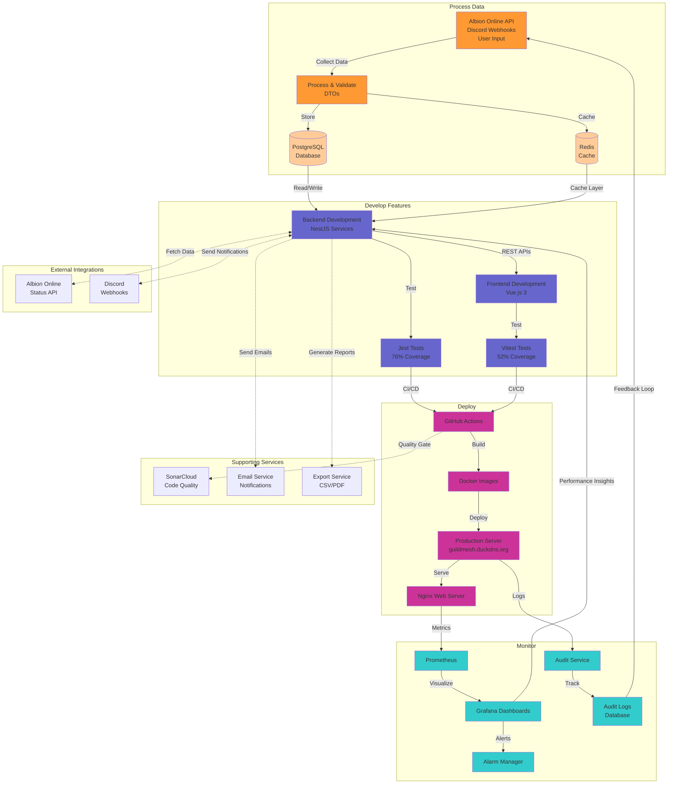

# Figura 2 – Arquitetura GuildMesh

## Legenda das Fases

### 🟧 Process Data (Processar Dados)
- **Albion Online API**: Coleta de dados do jogo (status do servidor, eventos)
- **Discord Webhooks**: Integração com Discord para notificações
- **User Input**: Dados inseridos pelos usuários (guildas, eventos, builds, finanças)
- **Process & Validate**: DTOs com class-validator
- **PostgreSQL Database**: Armazenamento principal (12 entidades)
- **Redis Cache**: Cache para melhor performance

### 🟪 Develop Features (Desenvolver Funcionalidades)
- **Backend Development**: NestJS com 17 serviços (Auth, Guilds, Events, Finance, Builds, etc.)
- **Frontend Development**: Vue.js 3 com Composition API e Tailwind CSS
- **Jest Tests**: 158 testes no backend (76% de cobertura)
- **Vitest Tests**: Testes no frontend (52% de cobertura)
- **REST APIs**: Comunicação entre frontend e backend

### 🟣 Deploy (Implantar)
- **GitHub Actions**: CI/CD automatizado (test.yml, deploy.yml, sonarcloud.yml)
- **Docker Images**: Containerização de todos os serviços
- **Production Server**: Servidor em guildmesh.duckdns.org
- **Nginx**: Web server para servir aplicação

### 🟦 Monitor (Monitorar)
- **Prometheus**: Coleta de métricas de performance
- **Grafana**: Dashboards visuais de monitoramento
- **Audit Service**: Serviço de auditoria para rastrear ações críticas
- **Audit Logs**: Registro de todas as operações (create/edit/delete)
- **Alarm Manager**: Sistema de alertas

## Serviços de Suporte

- **SonarCloud**: Análise de qualidade de código
- **Email Service**: Nodemailer para recuperação de senha e notificações
- **Export Service**: Geração de relatórios em CSV/PDF

## Integrações Externas

- **Albion Online Status API**: Dados em tempo real do jogo
- **Discord Webhooks**: Notificações automáticas para servidores Discord

## Feedback Loops

1. **Performance Feedback Loop**: Grafana → Backend Development (insights de performance)
2. **Audit Feedback Loop**: Audit Logs → Process Data (rastreamento de ações)
3. **Quality Feedback Loop**: SonarCloud → GitHub Actions (quality gates)

## Módulos Principais

| Módulo | Funcionalidade |
|--------|----------------|
| **Auth** | Autenticação JWT, login, registro, recuperação de senha |
| **Guilds** | Gerenciamento de guildas e membros (Leader/Officer/Member) |
| **Events** | Agendamento de eventos, RSVP, eventos recorrentes |
| **Finance** | Controle financeiro (receitas/despesas), histórico |
| **Builds** | Builds de personagens (309+ itens do Albion) |
| **Audit** | Log de ações críticas |
| **Export** | Exportação de dados (CSV/PDF) |
| **Reports** | Relatórios e estatísticas |

## Stack Tecnológico

**Backend**: NestJS, TypeScript, PostgreSQL, Redis, TypeORM
**Frontend**: Vue.js 3, Tailwind CSS, Pinia, Vite
**DevOps**: Docker, GitHub Actions, Prometheus, Grafana
**Security**: JWT, bcrypt, Helmet, Rate Limiting
**Quality**: Jest, Vitest, SonarCloud, ESLint
